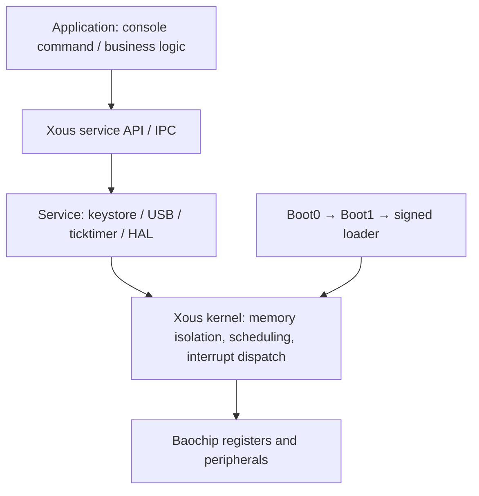
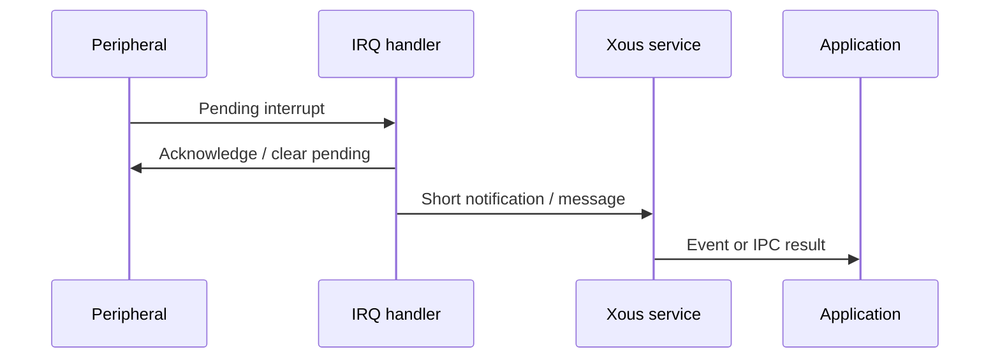
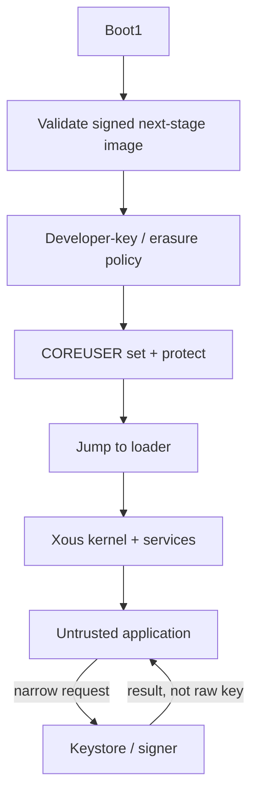

# Coding Guidelines for Baochip Dabao and Xous

> Companion to [the bring-up and security-audit notebook](README.md). Target baseline: Dabao / Baochip-1x **A0**, Xous **v0.10.1**. This is a **project policy and engineering recommendation**, not an official Baochip standard. Recheck upstream APIs and hardware behavior before porting to another board, silicon stepping, or Xous release.

## In plain English

Treat the Baochip as a **very small computer with security-sensitive hardware**, not as a Mac with less RAM. Put ordinary application logic in a Xous process. Ask services to perform hardware operations rather than poking registers directly. Keep loops bounded, use timeouts, never print secrets, and make flashing predictable. Assume that a developer-signed build is for experimentation, **not** a secure wallet holding real funds. Test first on the existing A0 development board, and don't change Boot0/Boot1 or security registers casually.

## Quick rules

1. **Pin versions:** record the Xous git commit/tag, toolchain, feature flags, board stepping and signing-key class for every release.
2. **Default to Xous user-space code.** Change the kernel, loader, HAL, Boot1, or Boot0 only for a documented reason and after separate review.
3. **No endless synchronous console commands.** Bound work by time, iterations, or explicit cancellation; yield or sleep while waiting.
4. **Do not assume Ctrl-C works.** The observed `test timer` busy-loop had no cancellation path.
5. **Use Xous IPC/service APIs for hardware.** Register ownership and access controls explicitly.
6. **Treat all USB, UART, GPIO, I²C, and external inputs as untrusted.** Bound lengths, parse strictly, and reject invalid states.
7. **Never log seeds, private keys, raw key slots, authentication tokens, or secret-bearing buffers.** Treat `test env` as sensitive diagnostic output.
8. **Never use `devkey/dev.key` to assert production trust.** Developer-key boot invokes a secret-erasure policy in Boot1.
9. **Avoid writes to RRAM security control, COREUSER, fuses, one-way counters, and boot partitions in application code.**
10. **Every interrupt handler must be short, acknowledge its source correctly, and preserve the lifetime of its context pointer.**
11. **Plan for power loss and incomplete writes.** Use checksums/versioning and verify data after storage operations.
12. **Measure memory and CPU usage on the real board.** There is only 2 MiB SRAM.
13. **Keep an explicit recovery plan:** PROG → Boot1 → UF2; know which firmware images and serial ports to expect.
14. **Separate observed facts from assumptions** in code comments, security claims, and documentation.

## 1. Hardware and runtime limits

| Property | Practical consequence |
|---|---|
| RV32IMAC RISC-V CPU (~350 MHz) | 32-bit pointers; prefer integer sizes intentionally; don't assume desktop SIMD, atomics or OS APIs. |
| 2 MiB integrated SRAM | Small process budgets, stacks, heaps, and buffers. |
| 4 MiB integrated RRAM | Nonvolatile but finite capacity; writes require driver/controller discipline. |
| A0 silicon | Some RRAM security bits are software-configurable; A1 comments describe stronger hardwiring. |
| Xous Sv32 memory isolation | Separate virtual address spaces, but no blanket guarantee against privileged-code compromise. |
| USB serial console | Port changes on Boot1 → Xous transition; don't hard-code a persistent device path. |
| Developer-signed firmware | May irreversibly erase device-specific secrets; do not infer original provisioning remains. |

Observed `test freemem` output listed **1000 k** across eight processes (kernel 144, ticktimer 92, keystore 92, logger 80, names 72, USB 120, HAL 288, console 112). **This is not a reliable free-heap metric**; account for reserved pages, stacks, fragmentation, and other allocations. Use real workload measurements and leave headroom.

### Memory and allocation conventions

- Prefer fixed-size buffers for protocol frames, hardware I/O, and ISR-adjacent paths; check every length before copying.
- Prefer `usize` for indexes and lengths, fixed-width `u32`/`u64` for wire and on-disk formats. Check conversions explicitly.
- Avoid unbounded `Vec` growth, recursive parsers, large stack arrays, and excessive per-request allocations.
- Check allocation failures and overflow; do not use `unwrap()` on attacker-controlled inputs.
- Use page-size-aware designs where relevant (observed allocations were 4 KiB multiples).
- Do not confuse **RRAM image space** with **SRAM runtime space**: build output's image free-space number is not available RAM.

## 2. Where code belongs



| Layer | Examples in v0.10.1 tree | Guideline |
|---|---|---|
| Application | `apps-dabao/dabao-console/src/cmds/` | Default home for experiments. |
| Service | `services/xous-ticktimer`, `services/usb-bao1x`, `services/keystore` | Use documented IPC contracts; minimize exposed operations. |
| Hardware abstraction | `services/bao1x-hal-service`, `libs/bao1x-hal` | Centralize register access, IRQ and DMA ownership. |
| Kernel | `kernel` | Change only when service isolation cannot solve the problem. |
| Boot/security | `bao1x-boot/boot0`, `bao1x-boot/boot1`, `loader` | Security-critical; independent review and recovery plan mandatory. |
| Generated register definitions | `utralib`, `svd2utra`, SVD files | Verify against the correct silicon stepping and RTL. |

**Rule:** An application that wants to blink an LED should use a supported HAL/API path, not map the GPIO registers itself. An application that wants a signature should request it from a narrowly authorized signer, not read private keys.

## 3. Console command conventions

The observed console supports `echo`, `ver`, `trng`, `i2cdetect`, `test`, `usb`, `ws2812`, `touch`. Do not assume other tutorials' commands are present in this exact build. In v0.10.1 the `ShellCmdApi` command implementation lives under `apps-dabao/dabao-console/src/cmds/`; examine the actual dispatcher before adding a new command.

**A command should:** validate arguments; print concise usage on bad input; avoid leaking secrets; use a finite deadline; return a meaningful result; and avoid panicking on malformed input.

### Anti-pattern: the observed infinite timer test

```rust
loop {
    let elapsed = env.ticktimer.elapsed_ms() - start;
    if elapsed > seconds * 1000 {
        log::info!("{} s", seconds);
        seconds += 1;
    }
}
```

This never returns, has no cancellation check, and busy-spins. The serial client can disconnect while the device keeps executing it.

### Recommended bounded-work pattern (illustrative pseudocode)

```rust
// PSEUDOCODE: adapt ticktimer API signatures to the pinned checkout.
let start = ticktimer.elapsed_ms();
let duration_ms = 5_000;
loop {
    let elapsed = ticktimer.elapsed_ms().saturating_sub(start);
    if elapsed >= duration_ms { break; }
    if cancel_requested() { break; } // only if a real cancellation channel exists
    ticktimer.sleep_ms(10)?;          // confirm return type before compiling
}
```

For an application without a cancellation channel, **omit** the `cancel_requested()` branch and enforce a hard deadline. Prefer a non-blocking command architecture if the console must remain responsive. Avoid busy loops; add timeout/error tests.

## 4. Interrupt and concurrency rules

Six IRQs were observed on the board and traced to code:

| IRQ | Owner | Handler / purpose |
|---|---|---|
| 1 | `usb-bao1x` | `composite_handler`, USB controller + software IRQ |
| 5 | `xous-log` | `main_uart_handler`, UART0–UART3 RX |
| 10 | `bao1x-hal-service` | `iox_irq_handler`, IOX/GPIO |
| 11 | `keystore` | `rram_handler`, software-triggered RRAM work |
| 20 | `xous-ticktimer` | `handle_irq`, timing |
| 30 | `bao1x-hal-service` | `timer_tick`, scheduling preemption |



- Register the correct IRQ constant generated from the SVD; **do not hard-code** IRQ numbers into unrelated applications.
- Keep ISR code minimal. Avoid allocation, blocking IPC, logging floods, and locks that can deadlock.
- Acknowledge the correct pending bits; follow each peripheral's required ordering.
- Use `try_send_message` or another ISR-safe mechanism where supported, and handle dropped/failed notifications.
- Pin or statically allocate handler state for the entire registration lifetime. The UART HAL explicitly documents a raw-pointer lifetime hazard in `unsafe register_handler`.
- Document who owns an IRQ and whether its pending bits represent multiple subchannels.
- Test interrupt storms, rapid repeated events, missed events, and restart behavior.
- **Preemption is not cancellation.** IRQ30 can allow other threads to run while a command remains stuck.

## 5. RRAM and persistence conventions

In `libs/bao1x-hal/src/rram.rs`, `SECURITY_MODE = 0xFC00` (bits 10–15). Normal control is `0xFC00`; write-command control is `RRC_CR_WRITE_CMD | SECURITY_MODE = 0xFC02`. Driver comments warn that **security bits must be included on every RRCR update**. The RRAM handler checks 0x20-byte destination alignment, uses volatile operations and compiler fences, issues load/write commands, restores normal mode, and flushes cache. **Do not duplicate this sequence in application code.**

- Use the existing RRAM service/driver, not direct `SFR_RRCCR` writes.
- Never change `SECURITY_MODE` in application code; treat register-level experiments as separate reviewed firmware.
- Align writes and respect the driver’s buffer and range constraints.
- Check for write failures and verify persisted data.
- For application state, use a versioned record format, checksum/integrity tag, and a power-loss-safe commit scheme.
- Distinguish *storage integrity* (detecting corruption) from *authenticity* (detecting malicious modification). A plain checksum is not authentication.
- Avoid frequent unnecessary writes to nonvolatile configuration counters.
- Do not store secrets in logs, crash reports, temporary staging buffers, or plaintext persistent files without a threat model.

### A0 versus A1

Boot1's `detect_stepping()` attempts to clear **bit 12 (code-area protection)**, reads back the register, and identifies A0 if the value changes. It writes `0xFC00` repeatedly to restore it. A1 is described in code comments as hardwiring certain protection behavior. **This does not prove all A0 protections are ineffective, nor that all A1 protections are unbreakable.** Consult [the RRAM RTL](https://github.com/baochip/baochip-1x/blob/main/rtl/modules/rrc/rtl/rrc.sv) and silicon documentation before making stronger claims.

## 6. Security conventions

### Threat model first

For each feature, record:
- Assets: firmware integrity, device secrets, wallet keys, transaction contents, signing authorization, user data.
- Adversaries: malicious USB host, malicious input/peripheral, compromised Xous app, compromised kernel, physical attacker.
- Trust boundaries: Boot1→loader, kernel→service, app→keystore, device→host, RRAM→RAM.
- Failure behavior: reject/lock out, recover, log only non-sensitive diagnostics.

### Boot and key handling



Source `bao1x-boot/boot1/src/secboot.rs` reads developer mode twice, checks IFR for disabled CM7/JTAG, validates next-stage signature, applies `hardened_erase_policy`, then calls `seal_boot1_keys()` and jumps. The order is intentional: erasure must precede sealing. The source itself warns that COREUSER helps against arbitrary **reads**, but sufficiently privileged arbitrary **execution** may forge ASIDs. Do not claim this is an invulnerable secure enclave.

**Development signing ≠ production signing.** The observed loader, kernel and app UF2 images were signed with `devkey/dev.key`. Booting developer-key firmware can erase provisioned secrets; it may be irreversible. **Do not assume a post-flash audit is possible**: the board owner recalls a founder warning that it is unavailable after the first developer-signed flash, and this has not been independently verified. Preserve the pre-flash audit privately.

**Do not use the present development setup for real-value cryptocurrency custody.** Before any wallet use, independently verify secure boot, key provisioning, signer isolation, anti-rollback, display/transaction verification, recovery, threat model, and reproducible builds.

### Secret-handling rules

- Keep private keys in a restricted signing service; expose signing of *validated, authorized messages*, not arbitrary key export.
- Do not use a console-supplied `SEED` as a wallet mnemonic or master seed.
- Do not log `test env` wholesale in public CI or issue reports; redact seed, identifiers and any sensitive memory.
- Use CSPRNG interfaces with appropriate entropy/health checks; never replace with time-based or predictable randomness.
- Validate transaction context on the trusted device, not only on the Mac.
- Avoid `unsafe` unless needed for hardware; document pointer lifetime, alignment, aliasing, bounds, concurrency and memory-ordering invariants.
- Zeroize secret buffers where feasible, while recognizing copies, caches, and compiler behavior complicate guarantees.
- Restrict access to key-related IPC endpoints; verify caller identity/authorization.
- Fail closed on malformed signatures, key identifiers, or firmware metadata.

### Security-critical code review checklist

- Are signature and version checks actually enforced on the boot path?
- Is the developer-key policy understood and explicitly accepted?
- Does every RRAM RRCR update preserve required security bits?
- Are COREUSER mappings set before protection is locked?
- Can untrusted callers reach raw RRAM, IRQ, DMA, or key APIs?
- Are ASID/privilege assumptions documented for A0 hardware?
- Are all sensitive diagnostics redacted?
- Is there a recovery path that doesn't require disabling security?
- Are destructive operations isolated and excluded from normal application workflows?

## 7. Build, test, flash, and recover

### Reproducible baseline

```sh
cd ~/Documents/Code/xous-core
git describe --tags --always
rustc --version
cargo --version
cargo xtask dabao dabao-console
ls -lh target/riscv32imac-unknown-xous-elf/release/{loader,xous,apps}.uf2
```

The v0.10.1 checkout on the observed Intel Mac needed a local workaround for `SVD_PATH` location mismatch:

```sh
ln -s utralib/SVD_PATH target/riscv32imac-unknown-xous-elf/release/build/SVD_PATH
```

Use only when the expected path is missing and the real `utralib/SVD_PATH` has been checked. This is **not** a recommended upstream fix; prefer a build-system correction.

### Suggested test pyramid

1. **Host unit tests:** parsers, command argument validation, state machines, serialization, bounds, timeout arithmetic.
2. **Property/fuzz tests:** malformed USB/I²C inputs, truncation, integer overflow, unexpected message order.
3. **Cross-build checks:** exact board feature set and both RISC-V target artifacts.
4. **Board smoke tests:** `help`, `ver xous`, `test proc`, `test freemem`, `test interrupts`.
5. **Hardware-in-the-loop:** GPIO events, repeated USB reconnect, power loss, RRAM write/recovery on *test data only*.
6. **Security review:** IPC authorization, memory mapping, signing paths, firmware provenance, key handling.

Never run `test panic` or the original infinite `test timer` in an unattended smoke test. A timeout on the Mac alone does **not** stop code already running on the board.

### Flashing checklist

- Record source commit, board stepping, signing key class, hashes of generated images, and test results.
- Decide whether this is an **app-only** update or a **loader/kernel/app** update; do not overwrite more than needed.
- Verify that `BAOCHIP` is the actual mounted bootloader volume and that UF2 files are from the intended build.
- Copy one UF2 at a time and watch for disconnect/remount/error; do not assume all copies succeeded.
- Expect USB serial enumeration to change from Boot1 to Xous (observed `...HKCZN01` → `...HKCZN03`).
- Use `tio /dev/cu.usbmodem...`; exit `tio` with Ctrl-T then Q.
- After reboot, verify `ver xous` and the feature you changed.
- Keep a known-good build and document PROG recovery; never rely on an unverified post-flash audit.

### Change review / pull request template

```markdown
## Purpose
## Target hardware and stepping
## Xous source revision and toolchain
## Changed trust boundaries / permissions
## Memory and CPU budget impact
## IRQ / DMA / RRAM impact
## Secret-handling and logging review
## Unit and on-board test evidence
## Flash and recovery plan
## Known limitations / unverified assumptions
```

## 8. Current limitations and open engineering questions

| Topic | Current confidence | Next investigation |
|---|---|---|
| A0 RRAM bit semantics | Partial | Inspect RRAM RTL and chip docs. |
| COREUSER protection against arbitrary execution | Explicitly limited in source | Threat-model ASID forgery and privilege transitions. |
| Developer-secret erasure after flashing | Policy visible; hardware result unknown | Seek official statement; do not assume audit remains available. |
| `test timer` cancellation | No cancellation in observed function | Add bounded loop or real cancellation channel. |
| IRQ30 enable timing | Initially disabled during boot | Trace subsequent enable path. |
| USB console Ctrl-C | Unverified | Inspect USB console parser and message dispatch. |
| Runtime free memory | Process allocations measured | Add reliable available-memory and high-watermark instrumentation. |
| RRAM wear/endurance and atomicity | Not measured | Obtain controller specs and test power-loss behavior. |
| Keystore permissions and signer isolation | Not audited | Review API and authorization before wallet work. |
| Build SVD_PATH mismatch | Workaround reproduced | Prepare minimal upstream patch and regression test. |
| Production security posture | Not established | Independent review, attestation, release key provenance. |

## 9. Recommended coding style

- Prefer small, single-purpose Rust modules and typed APIs over magic register numbers.
- Name units explicitly (`elapsed_ms`, `timeout_ms`, `buffer_len_bytes`).
- Use checked/saturating arithmetic where time wraparound or untrusted lengths matter.
- Return `Result` and contextual errors; reserve `panic!` for impossible internal invariants, not routine I/O failures.
- Keep `unsafe` blocks tiny, adjacent to safety comments and tests.
- Avoid `println!` or `log::info!` for high-frequency ISR paths; use rate-limited diagnostic counters.
- Prefer explicit states (`Idle`, `Waiting`, `TimedOut`, `Failed`) to implicit global flags.
- Record hardware assumptions in comments with source paths/commit, especially A0/A1 differences.
- Distinguish **examples/pseudocode** from code tested against the exact checkout.
- For changes touching trust boundaries, require review by someone other than the author.

## 10. Reference map

- [Field notebook and audit](README.md)
- [Xous upstream](https://github.com/betrusted-io/xous-core)
- `apps-dabao/dabao-console/src/cmds/test.rs`: timer, process, memory, IRQ diagnostics.
- `services/bao1x-hal-service/src/main.rs`: IOX IRQ and preemption timer.
- `services/usb-bao1x/src/hw.rs`: USB composite IRQ.
- `libs/bao1x-hal/src/udma/uart.rs`: UART IRQ dispatch and pointer lifetime warning.
- `libs/bao1x-hal/src/rram.rs`: RRAM writes, security mode, software IRQ.
- `libs/bao1x-hal/src/coreuser.rs`: hardware identity mappings and protect.
- `bao1x-boot/boot1/src/audit.rs`: stepping detection.
- `bao1x-boot/boot1/src/secboot.rs`: signature validation, developer-key policy, sealing.
- `bao1x-boot/boot1/src/main.rs`: bootwait and boot paths.
- `utralib/bao1x/core.svd`, `bao1x_peri.svd`: hardware register and IRQ definitions.
- [Baochip RRAM RTL](https://github.com/baochip/baochip-1x/blob/main/rtl/modules/rrc/rtl/rrc.sv)

**Scope note:** This guide combines confirmed observations from the existing notebook with conservative engineering recommendations. It does not claim that untested examples compile or that the board is production secure.
