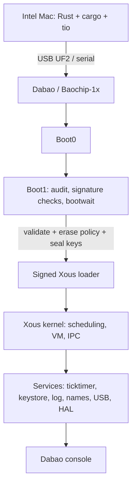
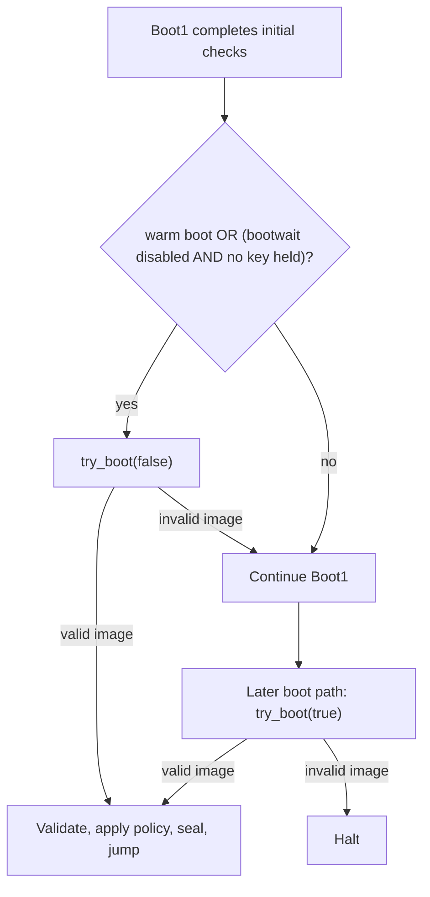
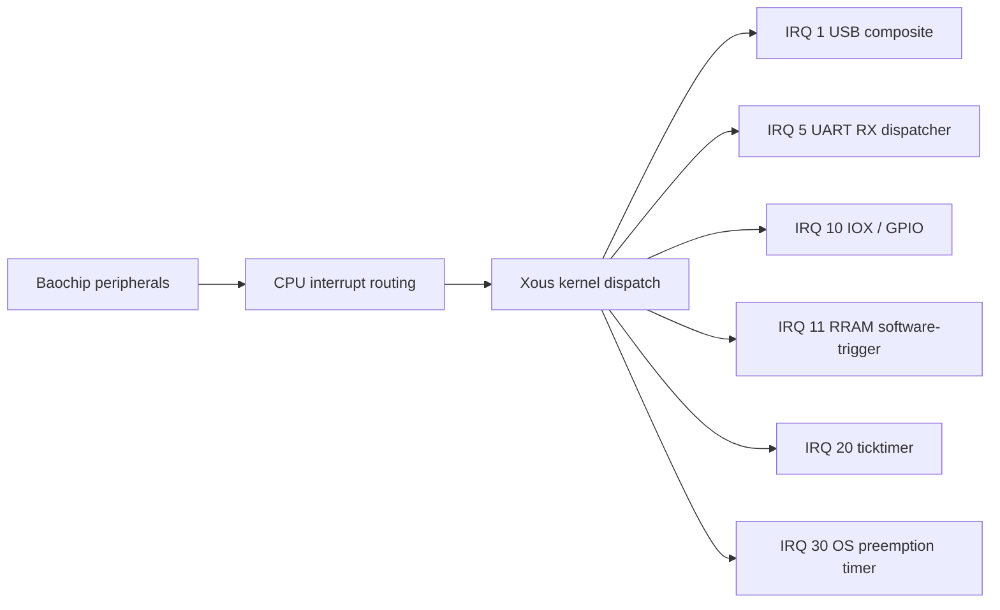
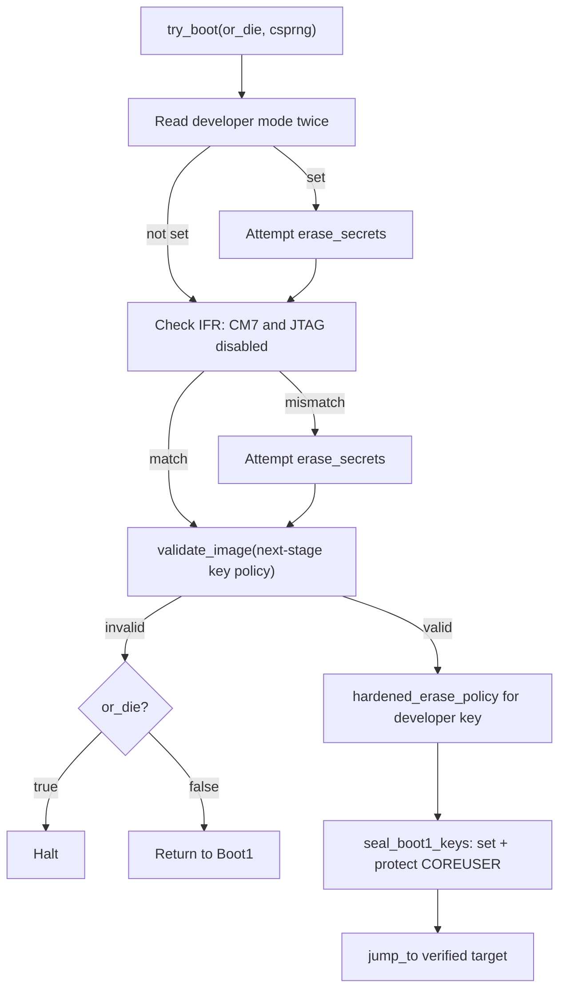

# Getting started with Baochip Dabao — field notebook and security audit

> Hands-on record: 22 November 2026. Hardware: Dabao, Baochip-1x A0. Host: Intel macOS x86_64. Xous source tag v0.10.1. This is a development notebook, **not** an independent security certification. Values and findings below distinguish observations, source-supported interpretations, and open questions.

## Plain-English overview

The Baochip is a tiny computer on a development board. Your Mac builds software for it; the chip executes that software. The chip has a RISC-V CPU, 2 MiB SRAM (working memory), and 4 MiB nonvolatile RRAM (firmware storage). Its boot chain starts with Boot0, then Boot1, then a signed loader, then Xous (a small operating system), then the console and services. A USB serial connection lets the Mac talk to either Boot1 or the Xous console. **Flashing repeatedly is normal**, but running developer-key-signed images can permanently erase provisioned device secrets. This board was explicitly accepted as a development board.

### Architecture



## Source links and provenance

- [Gerrit Niezen: Getting started with Baochip](https://gerritniezen.com/getting-started-with-the-baochip)
- [Baochip Dabao introduction](https://baochip.com/dabao-intro/)
- [RV Embedded bare-metal tutorial](https://rvembedded.com/blog_post/11/)
- [Xous source](https://github.com/betrusted-io/xous-core), checkout `v0.10.1`.
- [Baochip RTL RRAM controller](https://github.com/baochip/baochip-1x/blob/main/rtl/modules/rrc/rtl/rrc.sv).
- All terminal excerpts below came from a single user's development session. The listed source paths refer to the v0.10.1 checkout. No independent measurement of on-chip security enforcement was performed.

## Hardware and initial Boot1 audit (before development firmware)

Connect with a USB-C **data** cable, hold PROG while plugging in to enter Boot1. Find `/dev/cu.usb*`; use `tio /dev/cu.usbmodem...` or `screen <port> 1000000` for Boot1. Boot1 recognizes `audit`, `boot`, `bootwait`, `uf2`, `paranoid`, `lockdown`, `self_destruct`, etc. **Do not experiment with self_destruct, lockdown, IFR writes, or fuse-related commands.**

Recorded initial audit:

```text
Board type: Dabao
Boot partition: Ok(PrimaryPartition)
Semver: v0.10.0-61-g5397e1b48
Description: bao2-0
Stepping: A0
Public serial: HKCZN0
Paranoid mode: 0/0
Possible attack attempts: 0
Revocations: boot0, boot1, next stage key0..key3 all enabled
Boot0: key 0/0 (bao1) -> 60000000
Boot1: key 0/0 (bao1) -> 60020000
Next stage: key 2/2 (beta) -> 60060000
Erase proof: uninit or access denied
auto-audit limit: 3
In-system keys have been generated
CM7 & debug confirmed fused off
Collateral erased
Boot1 receipts OK
Boot1 anti-rollback OK
```

Device serializer, UUID, and full image hashes were present in the original terminal audit but are intentionally omitted from this public repository; preserve the original audit privately if needed. Hash categories included Boot0 partition/code-only, Boot1 partition/code-only, and toolchain hashes. The shared Boot0/Boot1 toolchain fingerprint was `441559d7e1984623ec0a52f60f90240c740b6c41`. No authoritative hash comparison was performed. **All enabled** means no listed key revoked, not that every key is trustworthy. The next-stage `beta` key warrants provenance review. `Erase proof: uninit or access denied` is inconclusive. The first `Command not recognized` before `audit` was harmless stray input.

### Bootwait and console differences

```text
bootwait disable  # attempt automatic boot on normal cold startup
bootwait enable   # wait in Boot1 on normal cold startup
boot              # attempt to start next stage now
```

Hold PROG during power-up to request Boot1 even when auto-boot is enabled; warm boots have special behavior. The bootwait preference is implemented with a one-way-counter scheme; logically changeable, but avoid needless repeated toggles. Verify behavior against the exact Boot1 build before relying on it.



## macOS installation and build: reproduced

Host diagnostics:

```text
uname -m                         -> x86_64
xcode-select -p                  -> /Library/Developer/CommandLineTools
git --version                    -> Apple Git 2.50.1
brew --version                   -> Homebrew 7.0.15
rustc --version                  -> 1.100.0
cargo --version                  -> 1.100.0
rustup --version                 -> 1.29.3
```

Install Rust from [rustup.rs](https://rustup.rs/), then `source "$HOME/.cargo/env"`. The project was located at `~/Documents/Code/xous-core`:

```sh
git clone https://github.com/betrusted-io/xous-core.git
cd xous-core
git fetch --depth 1 origin tag v0.10.1
git checkout v0.10.1
cargo xtask dabao dabao-console
```

First run downloaded the custom `riscv32imac-unknown-xous-elf` toolchain (release `1.100.0.1`) and `riscv32imac-unknown-none-elf` target after interactive confirmation. Services, loader, app, kernel all compiled, but packaging stopped after kernel compilation:

```text
Error: Os { code: 2, kind: NotFound, message: "No such file or directory" }
```

**Root cause discovered:** `xtask/src/builder.rs:934` expects `target/<target>/release/build/SVD_PATH`, while `utralib/build.rs` generated `build/utralib/SVD_PATH`. The generated file contained:

```text
utralib/bao1x/core.svd
utralib/bao1x/bao1x_peri.svd
```

Local workaround (not a permanent upstream fix):

```sh
ln -s utralib/SVD_PATH target/riscv32imac-unknown-xous-elf/release/build/SVD_PATH
cargo xtask dabao dabao-console
```

This resolved the failure. The missing `objcopy` and `objdump` executables were investigated but **not proven relevant**, and no extra GNU toolchain was required to complete this build. Warnings about deprecated `u64::MAX`, `fetch_update`, unused variables/dependencies did not prevent success.

Result: `target/riscv32imac-unknown-xous-elf/release/{apps,loader,xous}.uf2` all generated. Kernel image reported 1,172,224 bytes with 2,211,840 bytes remaining in its allocated image region (not free SRAM). All three were signed using `devkey/dev.key`, per build log.

### Flash and boot observations

The three UF2 files were transferred through the `BAOCHIP` USB volume; confirm volume and image paths before copying. Copy separately and stop if volume disappears unexpectedly:

```sh
FW=target/riscv32imac-unknown-xous-elf/release
cp "$FW/loader.uf2" /Volumes/BAOCHIP/
cp "$FW/xous.uf2" /Volumes/BAOCHIP/
cp "$FW/apps.uf2" /Volumes/BAOCHIP/
```

Flashing development-key images can trigger irreversible device-secret erasure. Back up important provisioning information before doing this on any other board.

Boot1 USB port was `/dev/cu.usbmodemHKCZN01`. Typing `boot` disconnected the serial interface; Xous re-enumerated at `/dev/cu.usbmodemHKCZN03`. `brew install tio`; `tio <actual port>`; exit tio with Ctrl-T then Q. `screen` shortcut confusion occurred: typed `k`/`K`/`:quit` reached Boot1 instead of Screen. `pkill screen` from another terminal ended the host session.

Xous console confirmed:

```text
[console] help
Commands: echo, ver, trng, i2cdetect, test, usb, ws2812, touch
[console] ver xous
Xous version: v0.10.1-0-gbcfdca404
Sun, 22 Nov 2026 11:11:26 +0800
[console] test
test [proc] [freemem] [interrupts] [panic] [timer] [env]
```

`test panic` deliberately panics. `test timer` has an unconditional busy loop; **there is no cancellation check in that function**. Ctrl-C is not established as a working cancellation path. Exiting tio disconnects only the Mac; power-cycle or hardware reset restarts the board without erasing firmware. A safer future code change is a bounded timer loop using the ticktimer sleep API, verified by compilation.

## Xous processes and memory (observed)

`test proc` reported eight processes:

| PID | Name | State | Threads / connections |
|---|---|---|---|
| 1 | kernel | Ready(100) | TID 2, conns 0/32 |
| 2 | xous-ticktimer | Sleeping | TID 2, conns 5/32 |
| 3 | keystore | Sleeping | TID 2, conns 5/32 |
| 4 | xous-log | Ready(1000) | TID 3, conns 3/32 |
| 5 | xous-names | Sleeping | TID 2, conns 2/32 |
| 6 | usb-bao1x | Ready(100) | TID 2, conns 7/32 |
| 7 | bao1x-hal-service | Sleeping | TID 8, conns 16/32 |
| 8 | unnamed, inferred dabao-console | Running(0) | TID 3, conns 7/32 |

Ready means schedulable, Sleeping means waiting, Running means executing. `satp` reports page-table control, `ASID` identifies address spaces, and `PPN` points to page-table root (output printed byte-aligned addresses). Each process had distinct ASID 1–8 and a `satp` with mode 1 (Sv32). Example PID8: `satp 0x820611a5`, ASID 8, PPN `611a5000`. TID is a thread identifier, not thread count.

`test freemem` reported (in `k`): kernel 144, ticktimer 92, keystore 92, log 80, names 72, USB 120, HAL 288, unnamed console 112; **1000 k total**. Against 2048 KiB physical SRAM this is ~49% by subtraction, **not a verified free-memory count**: other reservations and accounting may exist. All amounts are multiples of 4 KiB.

`test env` printed `ROOT_FILESYSTEM_HASH` (all zero), `SEED` (32 bytes), `PUBLIC_SERIAL=HKCZN0`, and a long hex `UUID`. The seed is **redacted** here because its sensitivity has not been established. Do not reuse or publish it as a wallet secret. Zero root filesystem hash does not prove secure boot is off. Boot1's UUID and Xous's environment UUID had different representations; equivalence was not established.

## Six interrupt handlers: verified from live table and source



| IRQ | Owner | Handler | Evidence |
|---|---|---|---|
| 1 | usb-bao1x | `composite_handler` | `services/usb-bao1x/src/hw.rs`, `IRQARRAY1_IRQ` |
| 5 | xous-log | `main_uart_handler` | `libs/bao1x-hal/src/udma/uart.rs`, `IRQARRAY5_IRQ` |
| 10 | bao1x-hal-service | `iox_irq_handler` | `services/bao1x-hal-service/src/main.rs`, `IRQARRAY10_IRQ` |
| 11 | keystore | `rram_handler` | `libs/bao1x-hal/src/rram.rs`, `IRQARRAY11_IRQ` |
| 20 | xous-ticktimer | `handle_irq` | `services/xous-ticktimer/src/platform/bao1x/implementation.rs` |
| 30 | bao1x-hal-service | `timer_tick` | `services/bao1x-hal-service/src/main.rs`, `TIMER0_IRQ` |

SVD `utralib/bao1x/core.svd` explicitly identifies irqarray10 value 10 and timer0 value 30. `svd2utra/src/generate.rs` generates Rust `*_IRQ` constants. Generated symbols were found inside binary `.rlib/.rmeta` files, not readable generated `.rs` files in the searched build directory.

USB `composite_handler` services controller IRQ and a software-trigger bit (`CORIGINE_IRQ_MASK=0x1`, `SW_IRQ_MASK=0x2`). IOX handler reads `irqarray10::EV_PENDING`, acknowledges it, then sends `HalOpcode::IrqLocalHandler` via `xous::try_send_message`. UART IRQ5 checks pending RX bits for UART0–UART3 and invokes per-channel callbacks, then clears pending bits. Its `register_handler` is `unsafe` because a raw pointer to pinned state must stay valid for the OS lifetime. RRAM IRQ11 uses bit 15 as a **software interrupt field**; do not assume it is triggered by every physical RRAM write. IRQ20 supports timing/sleep; IRQ30's `timer_tick` invokes `SysCall::ReturnToParent(PID 1, 0)` to force preemption and acknowledges `timer0::EV_PENDING_ZERO`. Its interrupt is initially disabled during early initialization (`timer_run=false`); enabling later was not traced. Hardware preemption is not the same as Ctrl-C command cancellation.

## RRAM controller: source audit

File `libs/bao1x-hal/src/rram.rs`:

```rust
pub const SECURITY_MODE: u32 = 0b1111_1100_0000_0000; // 0xFC00
const RRC_LOAD_BUFFER: u32 = 0x5200;
const RRC_WRITE_BUFFER: u32 = 0x9528;
const RRC_CR_NORMAL: u32 = 0;
const RRC_CR_POWERDOWN: u32 = 1;
const RRC_CR_WRITE_DATA: u32 = 0;
const RRC_CR_WRITE_CMD: u32 = 2;
const ATTEMPTS: usize = 2;
```

`SECURITY_MODE` sets bits 10–15; `RRC_CR_WRITE_CMD | SECURITY_MODE = 0xFC02`; normal mode `0xFC00`. Driver comments warn these security bits must be preserved on **every control-register update**, an error-prone compound-register design. In the inspected paths, normal writes preserve them. The SVD defines `SFR_RRCCR` as one 32-bit read/write field, **without decoding individual security bits**; inspect `rrc.sv` for semantics before asserting which regions are protected.

`rram_handler` acknowledges IRQ11, checks destination alignment (0x20 bytes) and buffer alignment, copies buffered words using volatile writes, uses compiler fences, issues load/write buffer command constants, restores normal control mode, then calls `cache_flush()`. Compiler fences alone are not full CPU hardware fences. `Reram::new` writes security mode; source comments say A1 stepping hardwires certain protection bits. The board is A0.

Read-only grep across `libs/bao1x-hal`, `services`, `bao1x-boot`, `loader`, `kernel` found register writes in `coreuser.rs`, `rram.rs`, Boot0 and Boot1 audit. Normal inspected paths set `SECURITY_MODE`. This search is **not a proof** there are no other register writes (e.g. raw addresses or other repositories).

### A0 versus A1 stepping detection

`bao1x-boot/boot1/src/audit.rs`:

```rust
rram.wfo(utralib::utra::rrc::SFR_RRCCR_SFR_RRCCR, bao1x_hal::rram::SECURITY_MODE);
rram.wfo(utralib::utra::rrc::SFR_RRCCR_SFR_RRCCR,
         bao1x_hal::rram::SECURITY_MODE & !(1 << 12));
let check_val = rram.rf(utralib::utra::rrc::SFR_RRCCR_SFR_RRCCR);
let ret = if check_val != bao1x_hal::rram::SECURITY_MODE { "A0" } else { "A1" };
```

Bit 12 is labeled **code area protection** in the comment. Boot1 tests whether it can be cleared: `0xFC00 -> 0xEC00`. Writable -> A0; still set -> A1. Then it writes `SECURITY_MODE` three times with `bollard!(die, 4)` hardening between operations; no final readback was shown. This test explains the initial audit's A0 report. Do not manually alter security bits.

### COREUSER identity isolation and limitations

`libs/bao1x-hal/src/coreuser.rs::protect()` maps default ASID 0 to least-trusted user, sets `CONTROL_INVERT_PRIV=1`, writes `PROTECT=1`, then restores `SFR_RRCCR=SECURITY_MODE`. The comment calls PROTECT a **one-way door** for mapping changes; permanence across power cycles has **not** been established. Comment: “User process 3 is trusted, the kernel is not!” This describes an intended hardware trust arrangement, not independently proven enforcement.

`bao1x-boot/boot1/src/secboot.rs::seal_boot1_keys()` invokes `cu.set(); cu.protect();`. Its source explicitly cautions that COREUSER helps against arbitrary **read** primitives, but sufficiently powerful arbitrary **execution** may forge ASIDs and bypass the mechanism. This is not absolute kernel-compromise protection.

## Boot1 secure-boot source flow



Detailed observed sequence: clock-skipping hardening and random delays; one-way counter developer mode read twice (`DEVELOPER_MODE`), with attempted `erase_secrets` if set; IFR bytes at `0x60400180` compared with a reference intended to confirm CM7/JTAG disabled, with erasure attempt on mismatch; read paranoid mode duplicated fields; `validate_image(BOOT1_TO_LOADER_OR_BAREMETAL,...)`; validate inverse key index; apply `hardened_erase_policy` for developer key; optionally validate again in paranoid mode; **after erasure policy** invoke `seal_boot1_keys()`; finally `jump_to(target, tag)`. The code prints “Developer key detected, ensuring secrets are erased” when matching the developer key slot/tag. This is a policy intent; actual post-flash erase state was not measured.

`try_boot(false)` on invalid image returns to caller; `try_boot(true)` on invalid image halts. In `bao1x-boot/boot1/src/main.rs`, line ~182:

```rust
if bu.get_flags().warm_boot() ||
   (boot_wait == BootWaitCoding::Disable && current_key.is_none()) {
    try_boot(false, &mut csprng);
}
```

The later line ~423 invokes `try_boot(true, csprng)` after the bootloader's interactive/loading flow. Warm boot takes precedence over bootwait; holding a key bypasses normal cold auto-boot. Initial hardware mesh and attack-policy checks occur before this branch. Automatic boot does **not** bypass signature validation or developer-key policy.

## Security status and unresolved items

**Observed:** Initial Boot1 audit healthy by its own report; A0 stepping; dev-signed loader, kernel and apps successfully booted; Xous process isolation and six registered IRQs visible; RRAM driver uses 0xFC00 security mode.

**Source-supported but not independently verified:** Boot1's key erasure policy; COREUSER mapping lock; RRAM code-area protection; debug fuse claims.

**Unresolved / recommended next tests:**
1. **Do not assume a post-flash Boot1 audit is available or meaningful.** The board owner recalls the chip founder warning that audit cannot be performed after the first developer-signed flash. This has not yet been independently verified against the exact Boot1 implementation. Preserve the initial audit as the pre-development baseline; do not recommend a repeat audit until the limitation is resolved. Developer-key boot invokes an erasure policy, so pre-flash provisioning status cannot be inferred from a later report.
2. Verify hashes/signing keys against trusted Baochip release material.
3. Inspect `rtl/modules/rrc/rtl/rrc.sv` for bits 10–15 and A0/A1 behavior.
4. Trace when the OS preemption timer is enabled.
5. Trace full key provenance, permissions, and cryptographic signing APIs before considering wallet key storage.
6. Upstream a robust SVD_PATH build fix rather than relying on the local symlink.
7. Make `test timer` bounded/cancellable; inspect console Ctrl-C support before claiming it exists.
8. Verify UF2 transfer/boot behavior across repeated resets and bootwait changes.
9. Inspect developer mode counter and erase proof reporting without invoking destructive commands.

## Handy read-only investigation commands

```sh
grep -Rn 'SFR_RRCCR' libs/bao1x-hal services bao1x-boot loader kernel
grep -Rn 'claim_interrupt' services/bao1x-hal-service/src services/usb-bao1x/src
grep -Rn 'try_boot(' bao1x-boot/boot1/src
sed -n '30,80p' bao1x-boot/boot1/src/audit.rs
sed -n '1,160p' bao1x-boot/boot1/src/secboot.rs
sed -n '145,175p' libs/bao1x-hal/src/coreuser.rs
grep -n -B 3 -A 5 '<name>timer0</name>' utralib/bao1x/*.svd
```

**Safety:** Never run `self_destruct`, `lockdown`, unreviewed `ifr` commands, or direct RRAM register writes as casual experiments. No part of this notebook requires them.


## Baochip peripheral guide

A plain-English guide to the Baochip-1x peripheral documentation is now available in [`peripherals/`](peripherals/README.md). It explains BIO, GPIO/pin muxing, uDMA, I²C, UART, SPI, I²S, SDIO/camera, ADC, PWM, clocks and safety sensors, with links back to the official register reference and source chapters.

