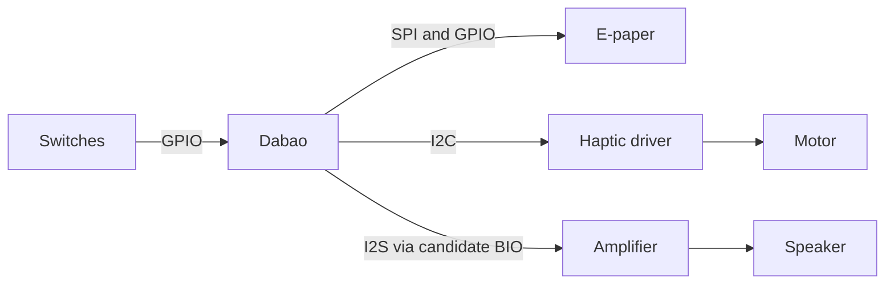

# Baochip component research library

Research snapshot: 2026-11-25. Companion project: [BaoBAB](https://github.com/angyts/BaoBAB), an experimental USB-powered Sepolia-only Ethereum signer. These are reusable notes, not an approved wiring schematic.

| Category | Parts |
|---|---|
| [Processor](processor/) | Dabao |
| [Display](display/) | Waveshare 2.13 HAT+ RTC, generic 8-to-24 adapter |
| [Inputs](inputs/) | Five-way SMD switch, TS-1088 |
| [Audio](audio/) | MAX98357A, 0.5 W 8 ohm speaker |
| [Haptics](haptics/) | DRV2605L, 1027 ERM |
| [Prototyping](prototyping/) | Perfboard, headers, UL1007 wire |
| [Test equipment](test-equipment/) | RE-YB1006 |

Evidence: owner purchase screenshots and component photographs, BaoBAB README/BOM/specification/security model, manufacturer references linked in each note. Chip datasheets do not establish clone breakout wiring. Unknowns are deliberately marked; none of the parts has been electrically tested here. Do not publish original order screenshots (personal information).

Bring-up: board alone, display, inputs, haptics, audio, combined load. Disconnect USB before wiring; verify shorts, logic levels and power budget. Never assume USB current equals spare 3.3 V regulator capacity. Record exact revision, pin mapping, idle/peak current, test firmware commit and pass/fail per module. No real funds or production security claims. AO3400 order refunded; not required with dedicated haptic driver.
